# Entity-Relationship Diagram (ERD)
## Store Monitoring System — Backend Laravel 13 + Inertia + React

> **Cara melihat diagram:** tempel blok Mermaid di bawah ke [mermaid.live](https://mermaid.live)
> atau Markdown viewer yang mendukung Mermaid (GitHub, Obsidian, VS Code).
> Untuk drawSQL: jalankan `php artisan migrate`, lalu ekspor skema database
> (`mysqldump --no-data`) dan impor SQL-nya ke drawSQL.app.

---

## 1. Konteks Arsitektur

- **Laravel 13.17** (PHP 8.3), monolit **Inertia.js 3** + **React**.
- **Autentikasi berbasis sesi** (bukan API token; Sanctum/Passport tidak terpasang).
- **Otorisasi**: `spatie/laravel-permission ^8.5` + **Policy/Gate** Laravel[reference:0].
- **Laravel Boost** menyediakan guideline AI agent agar kode mengikuti best practice Laravel 13[reference:1].
- **Database**: MySQL 8 / PostgreSQL 15 (driver default Laravel 13).
- **Cache & Queue**: driver `database` (default Laravel 11+) → tabel `cache`, `jobs`, `failed_jobs` tersedia.
- **Broadcasting**: tidak ada paket WebSocket → notifikasi dikirim lewat **polling** (Inertia partial reload).

---

## 2. ERD Lengkap

```mermaid
erDiagram
    %% ---------- IDENTITAS & MULTI-TENANT ----------
    TENANTS ||--o{ USERS : "memiliki"
    TENANTS ||--o{ STORES : "memiliki"
    TENANTS ||--o{ CATEGORIES : "memiliki"
    TENANTS ||--o{ PRODUCTS : "memiliki"
    TENANTS ||--o{ SUPPLIERS : "memiliki"
    TENANTS ||--o{ EXPENSE_CATEGORIES : "memiliki"
    TENANTS ||--o{ EMPLOYEES : "memiliki"
    TENANTS ||--o{ SETTINGS : "memiliki"
    TENANTS ||--o{ ROLES : "membatasi"
    TENANTS ||--o{ NOTIFICATIONS : "membatasi"
    TENANTS ||--o{ SALES_TARGETS : "menentukan"
    TENANTS ||--o{ DAILY_STORE_SUMMARIES : "mengagregasi"

    USERS ||--o{ STORE_USER : "ditugaskan"
    USERS ||--o{ TRANSACTIONS : "sebagai kasir"
    USERS ||--o{ CASHIER_SHIFTS : "membuka"
    USERS ||--o{ EXPENSES : "membuat"
    USERS ||--o{ NOTIFICATION_PREFERENCES : "mengatur"
    USERS ||--o{ MODEL_HAS_ROLES : "diberi"
    USERS ||--o{ MODEL_HAS_PERMISSIONS : "diberi"

    %% ---------- SPATIE LARAVEL-PERMISSION ----------
    ROLES ||--o{ MODEL_HAS_ROLES : "diberikan_via"
    ROLES ||--o{ ROLE_HAS_PERMISSIONS : "memiliki"
    PERMISSIONS ||--o{ ROLE_HAS_PERMISSIONS : "pada"
    PERMISSIONS ||--o{ MODEL_HAS_PERMISSIONS : "langsung_ke"

    %% ---------- CABANG & STAF ----------
    STORES ||--o{ STORE_USER : "memiliki_staf"
    STORES ||--o{ INVENTORIES : "menyimpan"
    STORES ||--o{ TRANSACTIONS : "mencatat"
    STORES ||--o{ CASHIER_SHIFTS : "menjalankan"
    STORES ||--o{ EXPENSES : "mengeluarkan"
    STORES ||--o{ ATTENDANCES : "mencatat"
    STORES ||--o{ EMPLOYEES : "mempekerjakan"
    STORES ||--o{ PURCHASES : "menerima"
    STORES ||--o{ STOCK_TRANSFERS : "sebagai_asal"
    STORES ||--o{ STOCK_TRANSFERS : "sebagai_tujuan"
    STORES ||--o{ DAILY_STORE_SUMMARIES : "diringkas_per_hari"
    STORES ||--o{ SALES_TARGETS : "ditargetkan"

    %% ---------- KATALOG ----------
    CATEGORIES ||--o{ PRODUCTS : "mengelompokkan"

    PRODUCTS ||--o{ INVENTORIES : "distok_sebagai"
    PRODUCTS ||--o{ PRODUCT_STORE : "dijual_via"
    PRODUCTS ||--o{ STOCK_MOVEMENTS : "bergerak"
    PRODUCTS ||--o{ TRANSACTION_ITEMS : "terjual_sebagai"
    PRODUCTS ||--o{ PURCHASE_ITEMS : "dibeli_sebagai"
    PRODUCTS ||--o{ STOCK_TRANSFER_ITEMS : "ditransfer_sebagai"

    %% ---------- PENGADAAN ----------
    SUPPLIERS ||--o{ PURCHASES : "memasok"
    PURCHASES ||--o{ PURCHASE_ITEMS : "berisi"

    %% ---------- LEDGER INVENTORY ----------
    INVENTORIES ||--o{ STOCK_MOVEMENTS : "dicatat_oleh"
    STOCK_TRANSFERS ||--o{ STOCK_TRANSFER_ITEMS : "berisi"

    %% ---------- PENJUALAN ----------
    CASHIER_SHIFTS ||--o{ TRANSACTIONS : "menaungi"
    TRANSACTIONS ||--o{ TRANSACTION_ITEMS : "berisi"
    TRANSACTIONS ||--o{ TRANSACTION_PAYMENTS : "dibayar_via_opsional"

    %% ---------- SDM ----------
    EMPLOYEES ||--o{ WORK_SCHEDULES : "dijadwalkan"
    EMPLOYEES ||--o{ ATTENDANCES : "hadir"
    EMPLOYEES }o--o| USERS : "boleh_punya_akun"

    %% ---------- KEUANGAN ----------
    EXPENSE_CATEGORIES ||--o{ EXPENSES : "mengklasifikasi"
```

---

## 3. Daftar Tabel per Kelompok

### A. Autentikasi & Multi-Tenant

| Tabel | Sumber | Fungsi |
|---|---|---|
| `tenants` | kustom | Entitas root multi-tenant |
| `users` | kustom (perluas default L13) | Semua login; `tenant_id` nullable untuk super-admin |
| `password_reset_tokens` | default Laravel | Alur reset password |
| `sessions` | default Laravel | **Autentikasi berbasis sesi** (tanpa Sanctum)[reference:2] |

### B. Otorisasi — `spatie/laravel-permission ^8.5`

| Tabel | Sumber | Fungsi |
|---|---|---|
| `permissions` | default paket | Katalog permission |
| `roles` | default paket + **migrasi ekstensi** | Tambah `tenant_id` agar role per-tenant |
| `model_has_roles` | default paket | User ↔ Role |
| `model_has_permissions` | default paket | User ↔ Permission langsung |
| `role_has_permissions` | default paket | Role ↔ Permission |

> **Penting:** Jangan ubah file migration vendor. Tambahkan `tenant_id` pada `roles` lewat **migration ekstensi terpisah** setelah `vendor:publish` dijalankan[reference:3].

### C. Master Data

`stores`, `store_user`, `categories`, `products`, `product_store`

### D. Inventory

`inventories`, `stock_movements`, `stock_transfers`, `stock_transfer_items`, `suppliers`, `purchases`, `purchase_items`

### E. Penjualan

`cashier_shifts`, `transactions`, `transaction_items`, `transaction_payments` *(opsional — hanya jika butuh pembayaran terpecah)*

### F. SDM

`employees`, `work_schedules`, `attendances`

### G. Keuangan

`expense_categories`, `expenses`

### H. Monitoring & Notifikasi

`sales_targets`, `daily_store_summaries`, `notifications`, `notification_preferences`, `settings`

### I. Infrastruktur Laravel 13 (tidak digambar di ERD)

`cache`, `cache_locks`, `jobs`, `job_batches`, `failed_jobs`

---

## 4. Yang Sengaja Tidak Disertakan (dan Alasannya)

| Tabel | Alasan |
|---|---|
| `personal_access_tokens` | Tidak ada Sanctum/Passport; autentikasi memakai sesi |
| `activity_log` (paket) | `spatie/laravel-activitylog` tidak terpasang; audit bisa dibuat manual (lihat PRD §10) |
| `media` / `attachments` | Tidak ada `spatie/laravel-medialibrary`; path file disimpan sebagai `string` |
| `push_subscriptions` | Tidak ada paket broadcasting; notifikasi via polling |